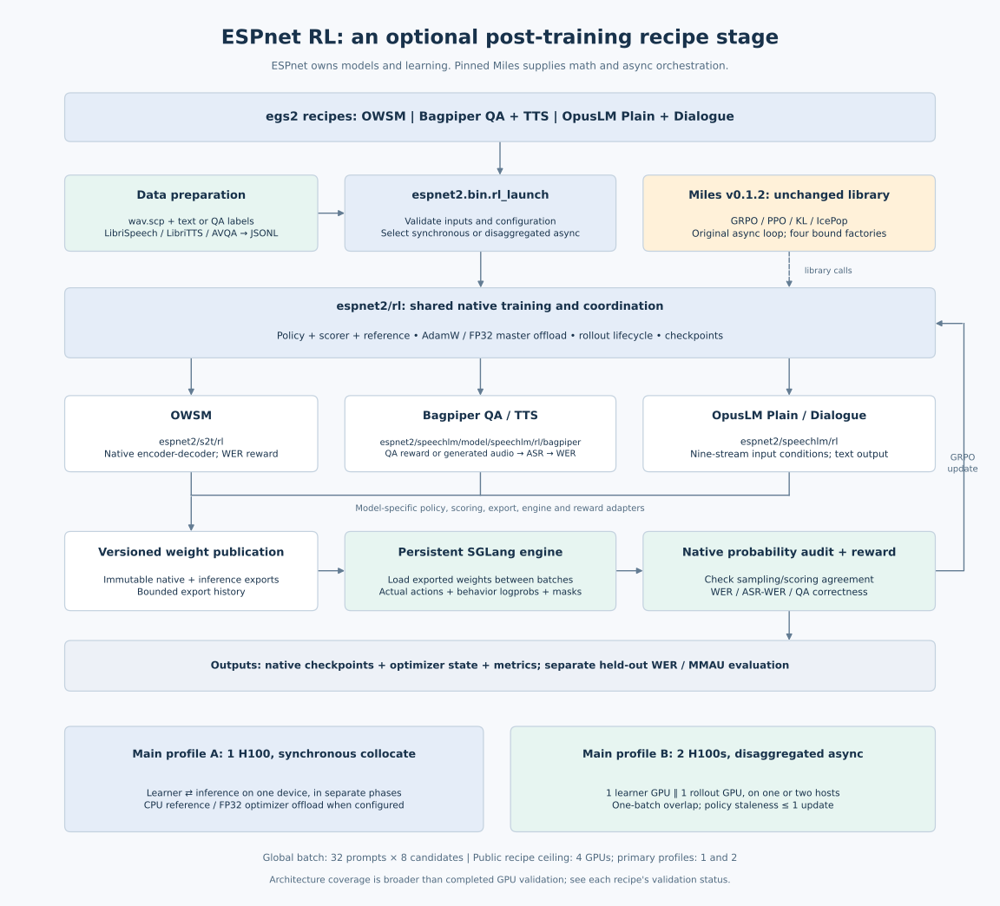

# Optional speech reinforcement learning in ESPnet

This feature adds RL after supervised training through existing ESPnet2 recipes.
It keeps the model adapters in ESPnet and uses a pinned, unchanged Miles library
with the reviewed SGLang inference fork.

Start with **[From a fresh checkout to speech training and RL](../espnet2/rl/ENVIRONMENT.md)**.
That guide includes host requirements, ordinary supervised training dependencies,
the isolated locked RL installation, source availability, CPU checks, model and
data preparation, and one-/two-GPU launch instructions.

## Repository entry points

| Topic | Documentation |
| --- | --- |
| Reproducible environment and exact source pins | [Environment setup](../espnet2/rl/ENVIRONMENT.md) |
| Component ownership, update contract and execution layouts | [Architecture](../espnet2/rl/ARCHITECTURE.md) |
| Public corpus / `wav.scp` preparation and recipe commands | [Recipe guide](../espnet2/rl/SHORT_RUN_RECIPES.md) |
| OWSM / LibriSpeech WER | [OWSM recipe](../egs2/owsm_v4/s2t1/README.md) |
| Bagpiper QA / AVQA and MMAU | [QA recipe](../egs2/bagpiper/speechlm1/README.md) |
| Bagpiper TTS / LibriTTS ASR-WER reward | [TTS recipe](../egs2/bagpiper_tts/speechlm1/README.md) |
| OpusLM Plain / Dialogue | [OpusLM recipe](../egs2/libritts/speechlm1/README_RL_OPUSLM.md) |

The public profiles keep 32 prompts × 8 candidates per optimizer update and
start with five updates. The main layouts are one H100 for synchronous
collocation and two H100s for disaggregated async; custom layouts should use at
most four GPUs. Large models may also need substantial CPU RAM. These layouts
are not a claim that every family has completed GPU acceptance or improved
held-out quality; the environment guide lists the current validation boundary.

This is the local, unpublished `codex/bagpiper-west-h100-fp32-20261016` feature
branch. The environment guide explains how to import the contributor's
`espnet-bagpiper-west-h100-fp32-20261016.bundle` and check its revision/hash
receipt; no public feature URL is assumed. A normal upstream ESPnet clone does
not automatically contain these changes before publication or merge.
