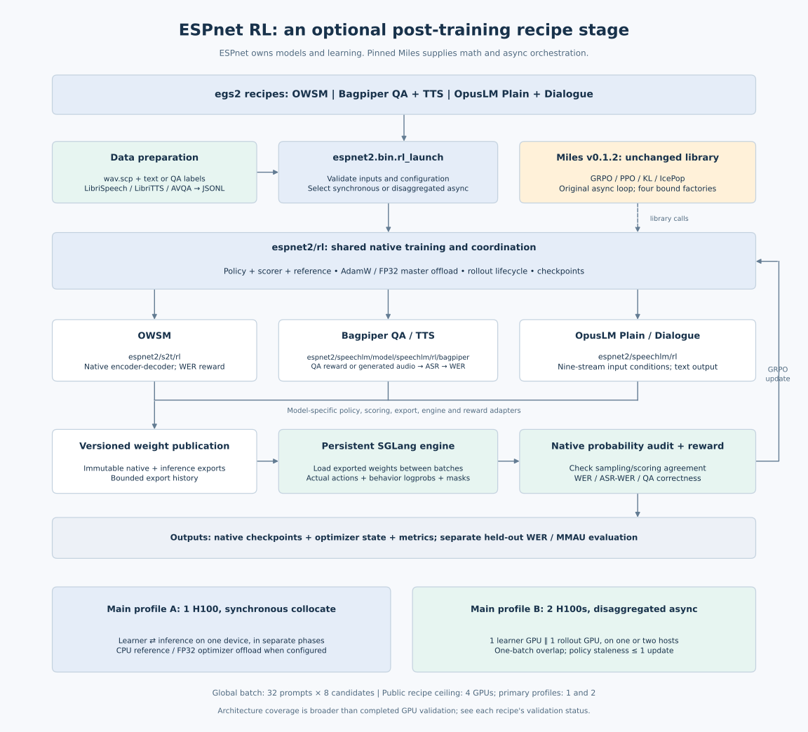
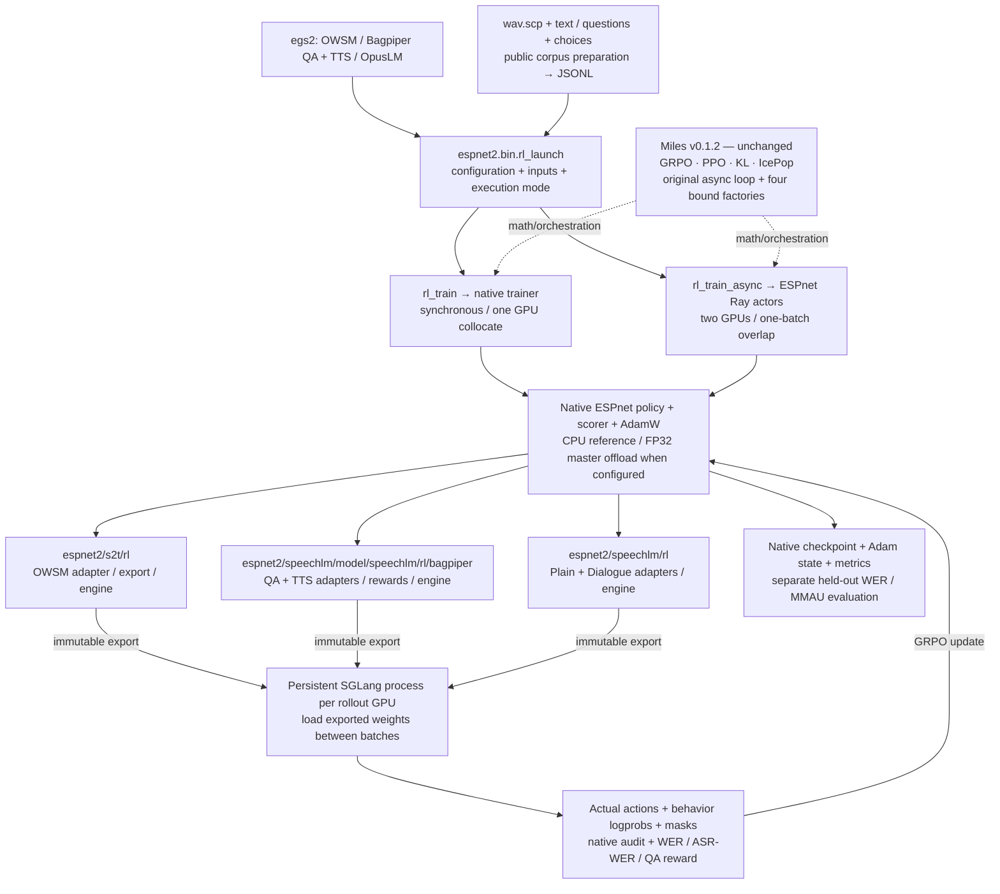
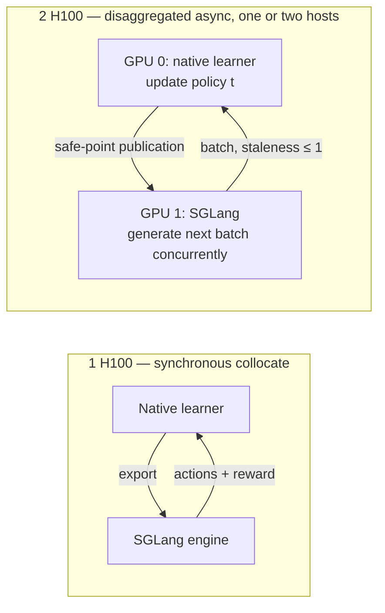

# ESPnet RL architecture

RL is an optional post-training stage of existing ESPnet recipes. Model-specific
adaptation stays with each model under `espnet2`; Miles stays an unchanged,
pinned library. This diagram describes the integrated implementation, including
paths that still need complete GPU validation for some families.

See [environment setup from a fresh checkout](ENVIRONMENT.md) for source pins,
installation commands, model assets and single-/two-GPU launch instructions.

## Ownership

| Location | Responsibility |
| --- | --- |
| `egs2/*` | Existing recipe plus optional RL stage, data choices and YAML profiles |
| `espnet2/bin/rl_launch.py` | Choose sync/async entry; scrub inherited launch identity |
| `espnet2/rl/data.py`, `prepare.py`, `corpus_subset.py` | Manifests, waveform preparation, optional hash-bound admission |
| `espnet2/rl/trainer.py`, `scoring.py`, `parallel_optimizer.py` | Native loss/backward, probability checks, optimizer, checkpoints |
| `espnet2/rl/engine.py`, `rollout.py`, `rollout_worker.py` | Persistent engine interface, subprocess lifetime and weight publication |
| `espnet2/rl/miles_library.py` | Verify the exact pin and call Miles mathematical APIs |
| `espnet2/rl/miles_async_driver.py`, `miles_components.py`, `miles_native_actor.py` | Bind original Miles async loop to ESPnet Ray workers |
| Architecture `rl/` directories | Model loading, sampled-action scoring, exact export, SGLang implementation, rewards/evaluation |
| `tools/installers` | Optional pinned source libraries and isolated environment profiles |
| `test/espnet2` | CPU contract regression checks; GPU evidence is separate |

The SGLang fork supplies registration bridges importing model implementations
from ESPnet. OWSM runs its native encoder/decoder with full-prefix generation
under SGLang's scheduler/sampler. Bagpiper uses SGLang Qwen3 layers and eight
streams; OpusLM uses Olmo2/Llama layers and native nine-stream input conditions
with text output. OpusLM codec-output RL is outside this implementation.

## Execution layouts

Collocation shares a device and schedules phases; it does not overlap learner
and inference computation. Two-GPU async overlaps one rollout batch with
training and verifies actual Ray placement. `fully_async=False` is intentional
in the pinned Miles arguments: this is a bounded one-step pipeline. More
replicas do not automatically improve speed. Public recipes use at most four
GPUs, with one and two as the main profiles. CPU RAM/transfer cost remains
substantial for large models.

## Update contract and limits

1. Load native policy, reference and optimizer; verify Miles and engine identity.
2. Publish an immutable native/inference export. Persistent engines load it
   between batches, keeping a bounded export history.
3. Generate candidates; save actual actions, behavior logprobs, model-specific
   masks/support and raw responses.
4. Recompute logprobs with the generating native policy. Stale async batches
   use its CPU snapshot for the audit; drift gates run before the update.
5. Compute task reward and within-prompt advantages, Miles PPO/KL and IcePop,
   then native backward, clipping and AdamW. Low-precision learners require
   CPU FP32 master weights.
6. Save native weights, optimizer state and metrics; evaluate separate held-out
   inputs with an explicit denominator.

The original Miles function is rebound through a private globals namespace
because this pin exposes factories as module globals. This is not a stable
plugin API: changing the pin requires reviewing the binding and its tests.
Interrupted-run training recovery is not implemented. Sampling currently
requires temperature 1 without top-p/top-k truncation; the separate temperature
experiment is not part of this delivery. Refer to family recipe documentation
for the distinction between implemented paths and complete GPU validation.
