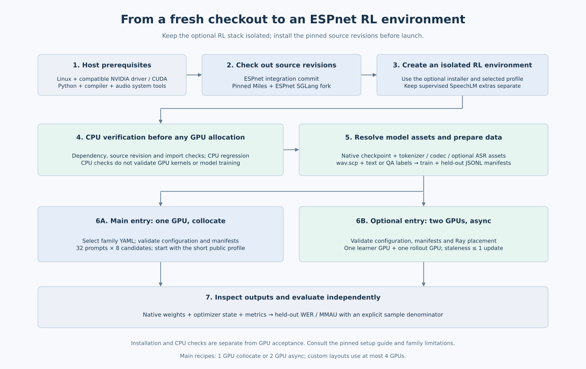
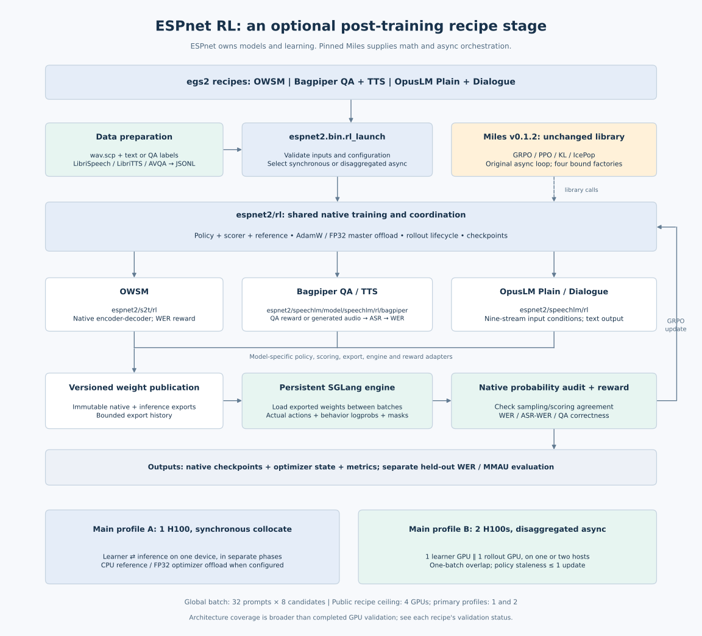

# From a fresh checkout to ESPnet speech training and RL

This guide covers two installations: ordinary supervised speech training
(ASR, TTS or SpeechLM), and the source-pinned Miles/SGLang RL environment.
Use separate Python environments and separate ESPnet checkout directories.
The instructions below prepare software; GPU training is an explicit later step.



For module ownership and the update loop, see the
[RL architecture](ARCHITECTURE.md). For corpus preparation and recipe stages,
see the [RL recipe guide](SHORT_RUN_RECIPES.md).

## 1. Choose the installation

| Goal | Installation | What it supplies |
| --- | --- | --- |
| Supervised ASR/TTS training | Section 3, ordinary ESPnet plus `train,asr,tts` extras | Training entry points and task-specific Python dependencies |
| Supervised SpeechLM training | Section 3, separate `train,speechlm` environment | The full supervised SpeechLM dependency stack |
| Speech RL using existing native models | Sections 4–8, locked native RL profile | ESPnet native learner, unchanged Miles library and the reviewed SGLang fork |

The current SpeechLM SFT extra requires Transformers **5.14.1** and
TileLang **>=0.1.12**; the reviewed RL profile uses **5.12.1** and **0.1.11**.
Installing `espnet[speechlm]`, running `make extra`, or upgrading packages inside
the locked RL environment would change that profile. Transfer native model
checkpoints and their matching assets between the environments instead.

**Source availability:** this RL implementation is a local, unpublished feature
branch, `codex/bagpiper-west-h100-fp32-20261016`, not an already merged upstream
release. An ordinary clone of
`https://github.com/espnet/espnet.git` provides standard ESPnet; it does not
by itself supply this RL feature or its four-GPU FP32 profile. Obtain the
reviewed source bundle and its exact revision/hash receipt from the contributor
before section 4. No public feature URL is assumed here. Once published or
merged, use the exact reviewed revision provided with that release.



## 2. Prepare a Linux host

The locked RL profile requires:

| Component | Requirement |
| --- | --- |
| OS / architecture | Linux x86_64; Ubuntu 24.04 is a suitable starting point |
| Python | CPython 3.12, including `venv`; this lock is not for Python 3.13 |
| C library | glibc >=2.39, required by the Miles router wheel |
| GPU driver | A CUDA 13.x-compatible NVIDIA driver; the driver-family floor is R580 |
| Main GPU layouts | One H100 80 GB for collocation; two for disaggregated async; four for the Bagpiper WEST FP32 profile |
| Larger-model host memory | CPU reference/master weights and Adam can require substantial RAM; Bagpiper templates suggest budgeting at least 192 GB, not a measured universal minimum |
| Storage / network | Space for multiple environments, model assets, corpus audio and checkpoints; access to GitHub, PyPI, NVIDIA/PyTorch wheel hosts and the selected model/data sources |

The platform facts are documented in the
[Ubuntu 24.04 release notes](https://documentation.ubuntu.com/release-notes/24.04/)
and [NVIDIA CUDA compatibility guide](https://docs.nvidia.com/deploy/cuda-compatibility/minor-version-compatibility.html).
The driver floor is not a guarantee that every optional JIT-compiled kernel
works on every device. This profile targets H100-class execution; a one-GPU
configuration does not imply that a smaller consumer GPU has enough memory.

For example, on Ubuntu 24.04, install host tools before creating the environment:

```bash
sudo apt-get update
sudo apt-get install -y git build-essential cmake pkg-config \
  python3.12 python3.12-venv python3.12-dev \
  libsndfile1 libsndfile1-dev sox libsox-fmt-all flac ffmpeg \
  curl wget unzip bc gawk
python3.12 --version
getconf GNU_LIBC_VERSION
```

An administrator must provide a compatible NVIDIA driver on a training host.
Do not install or replace a shared machine's driver as part of a recipe. The RL
installer uses binary dependencies and builds the two small pure-Python source
packages explicitly allowed by its lock. A full system CUDA toolkit is not a
requirement of its CPU installation check. Optional SFT extensions or a GPU
kernel's first compilation may additionally need a matching toolkit/compiler.

Use an absolute workspace path. The paths below are examples, not cluster paths:

```bash
export ESPNET_WORK="$HOME/espnet-work"
mkdir -p "$ESPNET_WORK/src" "$ESPNET_WORK/envs" \
  "$ESPNET_WORK/data" "$ESPNET_WORK/configs" "$ESPNET_WORK/runs"
```

## 3. Optional: ordinary supervised speech training

Skip this section if you already have a matching native model checkpoint and
only want RL. This follows ESPnet's
[standard installation](../../doc/installation.md) and the task extras declared
in `pyproject.toml`; it is separate from the hash-locked RL profile.

```bash
git clone https://github.com/espnet/espnet.git "$ESPNET_WORK/src/espnet-sft"
cd "$ESPNET_WORK/src/espnet-sft/tools"
./setup_venv.sh "$(command -v python3.12)" "$ESPNET_WORK/envs/sft"
. ./activate_python.sh
python -m pip install "torch==2.11.0" "torchaudio==2.11.0" \
  --index-url https://download.pytorch.org/whl/cu130
cd ..
python -m pip install -e '.[train,asr,tts]' \
  'torch==2.11.0' 'torchaudio==2.11.0'
python -m pip check
git rev-parse HEAD
python -m pip freeze > "$ESPNET_WORK/sft-python-packages.txt"
```

For supervised SpeechLM, use another clean environment/check-out pair and
install `'.[train,speechlm]'` instead of `'.[train,asr,tts]'`; consult
[SpeechLM installation](../speechlm/INSTALL.md) and the selected recipe's model
requirements. `train` is necessary: installing only the base package supports
inference, and installing only `speechlm` does not explicitly request all
training dependencies. These conventional SFT installs are resolved from their
checkout; they are not the RL profile's 233-artifact lock.

Some recipes need additional non-Python tools. With the SFT environment active:

```bash
cd "$ESPNET_WORK/src/espnet-sft/tools"
make sctk sph2pipe
```

Alternatively, the standard `make` workflow sets up recipe tools and the
training extra; explicitly choose its Torch/CUDA versions and provide any
compiler/toolkit needed by the optional extensions. Keep that workflow in the
SFT checkout. ESPnet2 does not require a complete Kaldi installation.

For a first small ASR recipe, use the [Mini-AN4 recipe](../../egs2/mini_an4/asr1/run.sh). On a host
where running a GPU job is authorized, its usual interface is:

```bash
cd "$ESPNET_WORK/src/espnet-sft/egs2/mini_an4/asr1"
./run.sh --ngpu 1 --nj 2 --inference_nj 2
```

That command prepares the bundled demo corpus and starts real training. It is not an
installation check. Other ASR/TTS recipes retain their own dataset, frontend,
vocoder and model requirements.

## 4. Obtain the reviewed RL sources

For this unpublished draft, obtain the contributor's source bundle named
**`espnet-bagpiper-west-h100-fp32-20261016.bundle`**, together with its SHA256 and
Git revision receipt. The name identifies a delivery artifact; this guide does
not claim that the bundle or feature branch is already publicly hosted. Clone
the supplied bundle into an independent clean checkout:

```bash
export ESPNET_RL_BUNDLE=/absolute/path/to/espnet-bagpiper-west-h100-fp32-20261016.bundle
export ESPNET_RL_GIT_REF=codex/bagpiper-west-h100-fp32-20261016
export ESPNET_RL_SOURCE="$ESPNET_WORK/src/espnet-rl"
sha256sum "$ESPNET_RL_BUNDLE"  # Compare with the supplied delivery receipt.
git clone --single-branch --branch "$ESPNET_RL_GIT_REF" \
  "$ESPNET_RL_BUNDLE" "$ESPNET_RL_SOURCE"
git -C "$ESPNET_RL_SOURCE" checkout "$ESPNET_RL_GIT_REF"
git -C "$ESPNET_RL_SOURCE" bundle verify "$ESPNET_RL_BUNDLE"
test -f "$ESPNET_RL_SOURCE/tools/installers/install_miles_async_env.sh"
test -f "$ESPNET_RL_SOURCE/egs2/bagpiper/speechlm1/conf/rl_west_4gpu_async.yaml"
git -C "$ESPNET_RL_SOURCE" rev-parse HEAD
```

Compare the printed commit with the supplied revision receipt. A clean local Git
checkout containing that same reviewed branch may replace the bundle as the
clone source. If a feature fork is later published, use its actual URL and
reviewed branch/tag. Do not substitute upstream `master` or the older
`codex/rl-local-wrapup-20261016` branch: the older branch does not contain this
four-GPU profile. Record the selected ESPnet revision with the environment receipt.

Clone the unchanged Miles library and reviewed SGLang fork at exact pins:

```bash
export ESPNET_MILES_SOURCE="$ESPNET_WORK/src/miles"
export ESPNET_SGLANG_SOURCE="$ESPNET_WORK/src/sglang"
git clone https://github.com/radixark/miles.git "$ESPNET_MILES_SOURCE"
git -C "$ESPNET_MILES_SOURCE" checkout --detach \
  a22fd824191c64ba7c5d6c531f125406e4ce9cc6
git clone https://github.com/whr-a/sglang.git "$ESPNET_SGLANG_SOURCE"
git -C "$ESPNET_SGLANG_SOURCE" checkout --detach \
  283d68c8bff309a42476c95f7c71dad895d09da6
```

| Locked component | Exact version / revision |
| --- | --- |
| Miles v0.1.2 | `a22fd824191c64ba7c5d6c531f125406e4ce9cc6` |
| SGLang fork | `283d68c8bff309a42476c95f7c71dad895d09da6` |
| Torch / Torchaudio | `2.11.0+cu130` / `2.11.0+cu130` |
| Transformers / NumPy | `5.12.1` / `2.3.5` |
| TileLang | `0.1.11` |

The complete authoritative lock is
[`requirements.txt`](../../tools/installers/miles_async/cp312_linux_x86_64_cu130/requirements.txt),
with platform, hashes and source pins in
[`profile.json`](../../tools/installers/miles_async/cp312_linux_x86_64_cu130/profile.json).
All three source checkouts must be clean. Keep generated configs/data/output
outside them; use separate installation copies rather than frozen run sources.

## 5. Build and activate the native RL environment

The target environment must not exist. The installer deliberately refuses
in-place environment repair and dirty/different source pins.

```bash
export ESPNET_RL_ENV="$ESPNET_WORK/envs/rl"
cd "$ESPNET_RL_SOURCE"
bash tools/installers/install_miles_async_env.sh \
  --python python3.12 --venv "$ESPNET_RL_ENV" \
  --espnet-source "$ESPNET_RL_SOURCE" \
  --sglang-source "$ESPNET_SGLANG_SOURCE" \
  --miles-source "$ESPNET_MILES_SOURCE" --with-tests
```

This installs 233 hash-checked dependency artifacts, then ESPnet and SGLang as
editables with no dependency re-resolution. Miles remains a source-only library;
its unused Megatron/backend extras are not installed. Rust SGLang extensions are
disabled in this Python profile. The installer hides GPUs and checks `pip check`,
actual import paths, the original Miles async entry and all four architecture
registrations. Its receipt is **`$ESPNET_RL_ENV.acceptance.json`**.

Activate the environment and make the source-only Miles library visible:

```bash
. "$ESPNET_RL_ENV/bin/activate"
export PYTHONPATH="$ESPNET_MILES_SOURCE"
python -m pip check
```

Use a dedicated shell; this explicit `PYTHONPATH` avoids an old dependency
overlay shadowing the checked sources. Persist these absolute paths in your own
activation script if needed. For legacy recipe wrappers that source
`tools/activate_python.sh`, point that file in the **RL checkout** to this
interpreter:

```bash
printf '. "%s/bin/activate"\n' "$ESPNET_RL_ENV" \
  > "$ESPNET_RL_SOURCE/tools/activate_python.sh"
```

Otherwise an old SFT activation file can silently replace the active interpreter
when a wrapper starts. Keep SFT in its own checkout and environment.

## 6. Check the installation without using a GPU

Inspect the installer receipt:

```bash
python - <<'PYCODE'
import json, os
from pathlib import Path
receipt = Path(os.environ['ESPNET_RL_ENV'] + '.acceptance.json')
x = json.loads(receipt.read_text())
assert x['passed'] and x['pip_check_exit_code'] == 0
assert x['artifact_count'] == 233 and not x['gpu_execution']
print('Source, dependency and import checks passed.')
PYCODE
```

With `--with-tests`, the implementation's CPU regression suite can be run from
the RL checkout. The options avoid repository-wide coverage-plugin assumptions
and same-named test modules in different directories:

```bash
cd "$ESPNET_RL_SOURCE"
CUDA_VISIBLE_DEVICES='' OMP_NUM_THREADS=2 MKL_NUM_THREADS=2 \
  python -m pytest -o addopts='' --import-mode=importlib -q \
  test/espnet2/rl test/espnet2/s2t/rl test/espnet2/speechlm/rl \
  test/espnet2/speechlm/test_rl_policy.py
```

The reviewed local implementation passed 273 tests, with one CUDA-specific test
skipped. That is CPU regression evidence, not proof of GPU memory fit, kernels,
completed training or improved quality for every architecture.

## 7. Supply model assets and training data

Installing software does not download pretrained models or prepare a corpus.
Use the native checkpoint and the exact training configuration/tokenizer/assets
that produced it. For existing model-specific download instructions, follow the
corresponding recipe README:

| Family | Required assets / task inputs | Recipe |
| --- | --- | --- |
| OWSM encoder-decoder | Native config/checkpoint and token list; LibriSpeech or `wav.scp` + `text` | [OWSM](../../egs2/owsm_v4/s2t1/README.md) |
| Bagpiper QA | Native SFT config/checkpoint, HF/tokenizer/audio/codec assets; AVQA or audio + questions + choices + reference answers | [QA](../../egs2/bagpiper/speechlm1/README.md) |
| Bagpiper TTS | Native SFT and codec assets; LibriTTS text/audio; a pinned Whisper ASR checkpoint for the reward | [TTS](../../egs2/bagpiper_tts/speechlm1/README.md) |
| OpusLM Plain / Dialogue | Native checkpoint/config, HF/tokenizer assets, original DAC/XEUS weights and k-means model; waveform/text pairs | [OpusLM](../../egs2/libritts/speechlm1/README_RL_OPUSLM.md) |

OWSM-CTC and OpusLM codec-output RL are not covered by this implementation.
Bagpiper TTS uses Transformers Whisper; a separate `openai-whisper` installation
is not required for that reward. Model permissions/downloads remain those of
each original release.

### Bagpiper: build the RL metadata from public sources

The [public SFT release](https://huggingface.co/espnet/bagpiper-sft/tree/5646600302bf2670214c601721e44f6d36145c26)
contains native weights and their YAML, but does not contain the shifted
`reference_assets` tokenizer required by the RL exporter. Download the native
release separately, then build the metadata in the RL environment:

```bash
hf download espnet/bagpiper-sft \
  --revision 5646600302bf2670214c601721e44f6d36145c26 \
  --local-dir "$ESPNET_WORK/models/bagpiper-sft"
CUDA_VISIBLE_DEVICES='' python -m \
  espnet2.speechlm.model.speechlm.rl.bagpiper.prepare_assets \
  --train-config "$ESPNET_WORK/models/bagpiper-sft/train_stage3_qwen3_base.yaml" \
  --output-dir "$ESPNET_WORK/models/bagpiper-rl-metadata"
```

Verify the release with its `SHA256SUMS` from inside the downloaded directory.
The published `model.pt` SHA256 is
`50980756fad38bbefeb326ac0012e39f431ec5af8c0caaac8bd254f179f33746`.
The helper's output directory must be new. It downloads **configuration and
tokenizer files only**, using these fixed upstream revisions:

| Metadata | Repository | Revision |
| --- | --- | --- |
| Text config/tokenizer | `Qwen/Qwen3-8B-Base` | `b86f722ec0768e8849ddeb2d8ce3a518bf4fd504` |
| Audio config/frontend | `Qwen/Qwen3-Omni-30B-A3B-Instruct` | `26291f793822fb6be9555850f06dfe95f2d7e695` |
| Codec config | `hf-audio/xcodec-hubert-general` | `240735a1ade315cb9b22604fe898e7df03d67378` |

No Qwen 8B/30B or codec weights are downloaded by this helper. Use its printed
`train_config` and `adapter_options` in the selected RL YAML, with `checkpoint`
pointing to the downloaded native `model.pt`. Keep the existing adapter options
for scoring, precision and memory. The new `native.yaml` resolves the text
backbone/tokenizer paths while preserving the released modality order. The
`asset_manifest.json` records sources, local paths and output-file hashes.

For an offline metadata build, supply all three `--text-assets`, `--audio-assets`
and `--codec-assets` directories containing the listed metadata files. Local
overrides are recorded as caller-supplied inputs; their public revision identity
is not independently verified. The helper refuses an unexpected vocabulary,
backbone, frontend or modality layout instead of deriving an offset from the
shorter tokenizer length. It retains 256 native special slots, 151,936 text
slots and eight codec streams of 1,025 IDs. It also merges the Qwen tokens that
are defined only in `tokenizer_config.json`.

The shifted tokenizer is for decoding the exported policy's output. Audio and
text prompts still go through the native SpeechLM preprocessor and original
text tokenizer from `native.yaml`; an HF chat template is not a replacement
for that multimodal frontend. CPU asset/tokenizer checks do not verify the
official checkpoint's complete tensor loading or native/SGLang probability
agreement. Run the selected recipe's numerical preflight with that checkpoint
before training. The recorded four-GPU experiment used a prepared native
checkpoint reconstructed from public `anonymous-release/vLLM_alm` revision
`83e02343f5647599c444b8ec91084b54576507f6`, rather than a verified tensor-equivalent
copy of this official SFT release. Its numerical evidence does not transfer
automatically to the public checkpoint.

For the experimental initialization, follow the separate
[recorded public HF reconstruction recipe](../../egs2/bagpiper/speechlm1/README.md#reconstruct-the-recorded-public-hf-initialization-optional).
It accepts explicitly downloaded local shards, verifies all four published
SHA256 values, preserves 1,381 source tensors and restores only the native
FP32 vocabulary-weight buffer. It also documents the historical metadata
normalizations, including corrected added-token IDs and native BOS/EOS/PAD;
the raw HF metadata must not silently replace the recorded reference bundle.
The source native YAML is public at SHA256
`d5a9e11f3af72bd14a02a02a8cd162f52a71bf4c701b93032de3b526c4d33b13`;
its recorded local copy changes only the backbone and text-tokenizer paths.
New serialization has its own hash. This optional reconstruction is neither
a verified official-SFT conversion nor a guarantee of exact experimental replay.

As a simple ASR example, prepare independent train/dev manifests from Kaldi-style
files whose utterance IDs match:

```bash
python -m espnet2.rl.prepare \
  --wav-scp "$ESPNET_WORK/data/train/wav.scp" \
  --text "$ESPNET_WORK/data/train/text" \
  --output "$ESPNET_WORK/data/rl_train.jsonl"
python -m espnet2.rl.prepare \
  --wav-scp "$ESPNET_WORK/data/dev/wav.scp" \
  --text "$ESPNET_WORK/data/dev/text" \
  --output "$ESPNET_WORK/data/rl_dev.jsonl"
```

The recipe guide also includes public LibriSpeech/LibriTTS archive preparation
and AVQA preparation. Use at least 32 distinct training prompts for the supplied
32×8 profiles. Public/user datasets do not require private project registries.
Optional data admission checks role-bound manifests, counts, audio hashes and
train/held-out independence; it does not rebuild external protection indexes.

Copy a model's template to `$ESPNET_WORK/configs/` and resolve these common fields:

```yaml
miles_source: /absolute/path/to/miles
sglang_source: /absolute/path/to/sglang
rollout_python: /absolute/path/to/rl-env/bin/python
train_config: /absolute/path/to/native/config.yaml
checkpoint: /absolute/path/to/native/model.pth
manifest: /absolute/path/to/rl_train.jsonl
eval_manifest: /absolute/path/to/rl_dev.jsonl
output_dir: /absolute/path/to/a/new/run
steps: 5
prompts_per_step: 32
group_size: 8
```

Also resolve the selected family's `adapter_options` assets. Relative paths in
native training configs may need resolving against the original model directory.
Use a new output directory for each run; interrupted-run training recovery is
not implemented.

## 8. Validate configuration, then choose a GPU layout

### One GPU: collocated synchronous training

Copy `egs2/owsm_v4/s2t1/conf/rl_miles_wer_1gpu.yaml`, resolve the fields above and
validate it without allocating a GPU:

```bash
python -m espnet2.bin.rl_launch \
  --config "$ESPNET_WORK/configs/owsm_1gpu.yaml" --validate-only
```

On an authorized GPU host, remove `--validate-only` to start real training.
The learner and persistent SGLang engine share GPU 0 in separate phases.
`32 × 8` remains the global candidate batch even when scoring uses microbatches.

### Two GPUs: disaggregated asynchronous training

Use `rl_miles_wer_2gpu_async.yaml`, resolve the same common fields, and keep a
separate output directory. In a fresh shell, activate the RL environment and
**export the Miles path before starting Ray**:

```bash
. "$ESPNET_RL_ENV/bin/activate"
export PYTHONPATH="$ESPNET_MILES_SOURCE"
ray start --head --num-gpus=2 --port=6379
ray list nodes
```

The driver and every Ray worker need these same source/interpreter settings.
An existing Ray daemon does not inherit environment changes made later. Use a
dedicated Ray cluster, outside torchrun and without inherited distributed-rank
variables. `RAY_NODE_IP` below is a Ray node's actual IP or ID, not an SSH proxy:

```bash
python -m espnet2.bin.rl_launch \
  --config "$ESPNET_WORK/configs/owsm_2gpu_async.yaml" \
  --ray-address auto --train-node RAY_NODE_IP --rollout-node RAY_NODE_IP \
  --validate-only
```

The same node selector places the two roles on separate GPUs of one host. For
two one-GPU hosts, join a worker with `ray start --address=HEAD_IP:6379
--num-gpus=1`, expose only one GPU on the head, and select each role's node.
Both hosts need the checked environment, Miles visibility, and identical absolute
source/model/data/output paths, normally via shared storage. Cross-host networking
and firewall connectivity need their own validation.

Validation checks inputs/configuration; it does not connect to Ray or verify live
placement. Removing `--validate-only` starts real training and records actual
placement. The pipeline overlaps the next rollout with the current update, with
weight staleness at most one; it uses Miles `fully_async=False`, not unrestricted
asynchronous updates. Supplied recipes use one, two or four GPUs; custom public
layouts should stay within four total.

### Four GPUs: Bagpiper WEST default with FP32

Use [rl_west_4gpu_async.yaml](../../egs2/bagpiper/speechlm1/conf/rl_west_4gpu_async.yaml)
after resolving the same source, model, data and output paths. Start a dedicated
Ray cluster exposing four H100 80 GB GPUs, and select its actual node ID for
both roles. The profile requests two learner GPUs and two independent TP=1
inference GPUs; the launch receipt and worker census record actual placement.
It retains 32 prompts × 8 candidates over 100 updates.

Both model paths use FP32. The native learner uses SDPA, and SGLang uses Triton
attention with IEEE float32 and 24 concurrent requests. BF16 attempts failed
the strict native/inference probability gate; FP32 numerical preflight passed
on 32 candidates with maximum log-probability error 0.000117779. The 0.03 gate
is unchanged. This preflight performed zero optimizer updates; full training
and MMAU quality acceptance remain pending.

Keep CPU AdamW, native layer/head checkpointing, a 2048-token micro-batch budget,
and activation CPU offload. `reference_cpu_offload: true` stores the reference
on CPU between passes and scores it on each rank's GPU selected by
`reference_device: null`. It returns to CPU before actor backward. Actor and
reference still coexist during reference scoring: their FP32 state tensors
alone total about 67.76 GiB, excluding activations, CUDA workspaces and other
allocations. Provide substantial host RAM and measure both CPU and GPU peaks;
successful environment installation does not establish memory fit.

## 9. Understand the validation boundary

| Check | What success means |
| --- | --- |
| Installer receipt / `pip check` | Source pins, locked artifact metadata and imports agree |
| CPU tests | Native data/loss/optimizer/orchestration contracts pass without GPU execution |
| `--validate-only` | Configuration and manifest checks pass; no model/GPU fit claim |
| GPU short run | Must separately show real generation, probability audit, nonzero updates, outputs and terminal success |
| Held-out evaluation | Must use its own denominator/protocol; a higher sampled reward alone is insufficient |

OWSM has existing single-/two-GPU 200-update engineering evidence, without a
held-out WER gain. Bagpiper's new small-GPU full loop and OpusLM's two-GPU full
loop still need acceptance. Earlier large-GPU or component measurements do not
establish those missing results. Full MMAU improvement is not established.

Common installation failures:

- **Existing venv / dirty source / wrong pin:** use a new environment and clean
  reviewed sources; do not bypass the source/hash checks.
- **Old glibc:** use a compatible OS/container image. A Python venv does not
  upgrade the host C library, and a container does not replace the host driver.
- **`No module named miles` in Ray:** export its source path before starting the
  dedicated Ray processes on every host, not just in the driver shell.
- **Wrong interpreter in an `egs2` wrapper:** inspect the RL checkout's
  `tools/activate_python.sh`; keep the SFT activation in another checkout.
- **Changed Transformers/TileLang after installing SFT extras:** recreate the
  locked RL environment; use a separate environment for full supervised SpeechLM.
- **Model or audio assets missing:** resolve the matching native release and
  prepared manifests. Installing the Python environment does not supply them.
