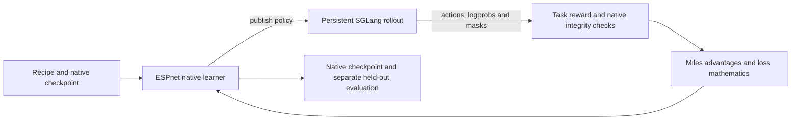

# Speech reinforcement learning with Miles

ESPnet owns the native speech model, preprocessing, sampled-action scoring,
rewards, optimizer and checkpoints. The unchanged Miles library supplies GRPO
advantages, PPO/KL/importance-weight mathematics and bounded asynchronous
orchestration; SGLang supplies rollout scheduling and model layers. Start with
[environment setup](ENVIRONMENT.md), then use one training command:

```bash
python -m espnet2.bin.rl_train --config /absolute/path/to/recipe.yaml
```

This is a local integration, not an already merged upstream release. The older
`rl_launch` and `rl_train_async` module names are compatibility entries. Existing
supervised recipe stages retain their behavior.

## Architecture and ESPnet2 placement

```text
egs2/<model>/<task>/             recipe stages and model/task configuration
espnet2/bin/rl_train.py          public command
espnet2/rl/cli.py                configuration, validation and execution selection
espnet2/rl/                      native trainer and Miles/rollout adapters
espnet2/s2t/rl/                 OWSM policy, exporter, rollout and WER evaluation
espnet2/speechlm/rl/            OpusLM policy, exporter and ASR evaluation
espnet2/speechlm/model/speechlm/rl/bagpiper/
                               Bagpiper policy, data, QA/TTS reward and evaluation
```

ESPnet2 is the integration point because OWSM and SpeechLM already provide the
native model classes, preprocessors, configuration/checkpoint formats and `egs2`
recipes here. Reusing those components preserves the supervised-to-RL boundary
without porting the models or maintaining a second training model. ESPnet3 is
not a prerequisite for this adapter; a later migration should reuse its public
model and training interfaces rather than create a parallel implementation.



The core imports the pinned Miles source, not its Megatron model backend. The
asynchronous adapter binds the original `train_async.py` function to ESPnet
actors; this pin exposes module globals rather than a stable plugin interface.
The adapter and its contract tests must be reviewed when changing that pin.

## Main configurations: one or two H100 GPUs

All main templates use **32 prompts × 8 candidates = 256 responses per update**
and five default updates. Microbatches reduce memory without changing that
batch. Increase `steps` deliberately and provide enough distinct source records.

| Task and recipe directory | One GPU, collocated | Two GPUs, asynchronous | Reward |
| --- | --- | --- | --- |
| OWSM ASR: `egs2/owsm_v4/s2t1` | `conf/rl_miles_wer_1gpu.yaml` | `conf/rl_miles_wer_2gpu_async.yaml` | Negative normalized WER |
| Bagpiper QA: `egs2/bagpiper/speechlm1` | `conf/rl.yaml` | `conf/rl_disagg_async.yaml` | Existing `qa_v1_reward`: accuracy and format, equal weights |
| Bagpiper TTS: `egs2/bagpiper_tts/speechlm1` | `conf/rl.yaml` | `conf/rl_disagg_async.yaml` | Generated audio → frozen ASR → negative WER |

One-GPU `sync` alternates learning and rollout on the same device. Two-GPU
`disagg_async` uses disjoint learner/rollout devices and overlaps one batch,
with at most one version of policy lag. Persistent engines load each published
policy in place. Neither mode creates a cluster allocation or serving group.

Earlier frozen OWSM revisions have complete one-/two-H100 200-update evidence.
OWSM and Bagpiper TTS GPU regression on this refactor remains pending. Bagpiper
QA passed five-update engineering acceptance on one and two H100s, including
strict probability/support checks, weight-publication acknowledgments, clean
exit and CPU checkpoint audits. Matched bounded greedy evaluations completed
32 items each for SFT and both final native checkpoints. The two-GPU final had
one token-limit truncation, retained in the full 32-item denominator. These
short checks do not establish long-run stability, a quality gain or full MMAU
results. Large models also need substantial host RAM; see
[resource planning](ENVIRONMENT.md#resource-planning).

The Bagpiper QA templates use FP32 native SDPA and SGLang Triton
attention with IEEE FP32 arithmetic, CPU Adam and GPU reference scoring with
CPU storage between passes. They use at most two candidates and 2,048 padded
tokens per microbatch, preserving the complete 32 × 8 update. One GPU uses
`miles_shm`; two GPUs use Miles NCCL.

Observed means across the four non-warmup update intervals were:

| Measured time (s/update) | One H100, synchronous | Two H100s, asynchronous |
| --- | ---: | ---: |
| Native learner | 377.540 | 426.046 |
| Outside native | 413.158 | 70.406 |
| Update cadence | 790.699 | 496.452 |

These intervals exclude startup and final checkpoint/publication/cleanup.
Table cells are rounded independently. Outside-native time already includes
its rollout/publication waits. Layouts differ in overlap and behavior auditing;
these measurements do not isolate a transport speedup or demonstrate linear
GPU scaling.

OpusLM remains supported through `egs2/libritts/speechlm1` and its
[task guide](../../egs2/libritts/speechlm1/README_RL_OPUSLM.md). Plain OpusLM's
main template uses two GPUs; no accepted one-GPU profile is claimed. Existing
configuration aliases resolve to the same files, not additional recipes.

## More tasks: speaker, long-form and multi-speaker

`espnet2/rl/task_rewards.py` adds the rewards below. All but the last score
generated text, so any family whose engine emits text can train them: OWSM,
OpusLM, OpusLM Dialogue and Bagpiper. `espnet2/rl/task_data.py` prepares most
of their manifests from ordinary Kaldi recipe inputs.

| Task | Reward | Supervision each record carries | Recipes |
| --- | --- | --- | --- |
| Closed-set speaker identification | `speaker_id_reward`: correct label 1 + terminal format 0.1 | `speaker`, `speaker_choices` | `egs2/libritts/speechlm1/conf/rl_opuslm_dialogue_speaker_id_1gpu.yaml`, `rl_opuslm_speaker_id_2gpu_async.yaml`, `egs2/bagpiper/speechlm1/conf/advanced/rl_speaker_id.yaml` |
| Long-form ASR | `longform_wer_reward`: `-min(WER, 1)` | `reference`, `min_reference_words` | `egs2/owsm_v4/s2t1/conf/rl_miles_longform_wer_1gpu.yaml`, `rl_miles_longform_wer_2gpu_async.yaml`, `egs2/libritts/speechlm1/conf/rl_opuslm_dialogue_longform_wer_1gpu.yaml`, `rl_opuslm_longform_wer_2gpu_async.yaml` |
| Two-speaker ASR | `multispeaker_cpwer_reward`: `-min(cpWER, 1)` | `references`, `speaker_tags` | `egs2/bagpiper/speechlm1/conf/advanced/rl_multispeaker_cpwer.yaml` |
| Two-speaker ASR from a policy that does not yet comply | `multispeaker_cpwer_shaped_reward`: cpWER plus two terms bounded by `CPWER_SHAPING_WEIGHT` | `references`, `speaker_tags` | `egs2/bagpiper/speechlm1/conf/advanced/rl_multispeaker_cpwer_shaped.yaml` |
| Speaker verification (same/different) | `speaker_verification_reward`: correct verdict 1 + terminal format 0.1, with per-class counters | `verdict`, `verdict_choices` | `egs2/bagpiper/speechlm1/conf/advanced/rl_speaker_verification.yaml` |
| Several tasks in one update | `mixed_task_reward` | `reward_task` per record | `egs2/libritts/speechlm1/conf/rl_opuslm_dialogue_mixed_1gpu.yaml` |
| Nine-stream codec generation | `codec_block_reward`: decodable share of the sampled block, plus 0.25 if the policy closed it | `codec_metadata` | `egs2/libritts/speechlm1/conf/rl_opuslm_dialogue_multistream_tts_1gpu.yaml` |

Two of these need a starting condition the table cannot show.
`multispeaker_cpwer_reward` is flat wherever the response is worse than
silence, which is where an audio *captioner* policy starts: every candidate of
every group clips to the same value, the GRPO group advantage is identically
zero, and no number of updates moves the policy. Measured on 256 mixtures at
0.3 overlap with one unchanged Bagpiper policy and the preparer's default
instruction: 1 distinct reward over the whole set. Use the shaped reward
*and* `--prompt-template verbatim_tagged` (below) in that case; the same
policy and mixtures then give 29 distinct rewards, and 200 steps took cpWER
mean 1.6177 to 0.0626, with 249 of 256 mixtures improved and none worsened.
`codec_block_reward` is shape-only on purpose -- it reports whether the policy
made decodable audio and closed the block, not how the audio sounds, because a
quality reward needs a codec decoder and a frozen ASR on a GPU and this one
runs on CPU with every other reward.

Every reward exposes `validate_sources(records)`, which `read_manifest` calls
before any model, GPU or Ray actor starts, so a manifest that cannot supervise
the configured task is rejected there rather than scored as a failure during
training. The long-form contract also enforces the declared
`min_reference_words`, so a short-utterance corpus cannot be trained as
long-form by pointing a config at it.

`speaker_id_reward` matches a label as whole words, so "1263" is not found
inside "12634"; a response naming two candidates earns no accuracy, because it
chose nobody. `longform_wer_reward` keeps WER as the reward and reports
`length_ratio`, `truncated` and `repeat_rate` separately, which is what
distinguishes the two long-form failures a single WER number hides: stopping
early and looping. `multispeaker_cpwer_reward` splits the response on the
speaker tags the prompt asked for, concatenates each speaker's turns in order
and takes the permutation of streams to references with the fewest total word
errors, normalizing by total reference words as CHiME's cpWER does; tag order
therefore never decides the score, and text before the first tag is counted as
unassigned rather than credited to the first speaker.

`mixed_task_reward` trains several tasks in one update: each record declares
its `reward_task` and is scored by that task's reward, named either as a
built-in (`asr_wer`, `longform_wer`, `speaker_id`, `multispeaker_cpwer`) or as
an explicit `module:callable`. Mixing reward scales is safe because GRPO
normalizes inside a prompt group: the trainer passes the per-prompt `uid` to
`compute_grpo_outcome_advantage`, which groups candidates by that id before
Miles normalizes, so two tasks never share a baseline. Because
`outcome_rewards` requires one fixed set of logged components, the mixed reward
reports `share_<task>` and `sum_<task>` per task; one task's mean batch reward
is `reward/sum_<task>` divided by `reward/share_<task>`.

Prepare each task from its recipe's own data directory:

```bash
python -m espnet2.rl.task_data --task speaker_id \
  --wav-scp data/train/wav.scp --utt2spk data/train/utt2spk \
  --speaker-choices 4 --seed 42 --output data/rl/speaker_id_train.jsonl
python -m espnet2.rl.task_data --task longform_wer \
  --wav-scp data/train/wav.scp --text data/train/text \
  --train-config /path/to/model/train.yaml \
  --min-reference-words 50 --concatenate 2 \
  --output data/rl/longform_train.jsonl
python -m espnet2.rl.task_data --task multispeaker_cpwer \
  --wav-scp data/train/wav.scp --text data/train/text \
  --utt2spk data/train/utt2spk --overlap 0.3 \
  --output data/rl/cpwer_train.jsonl
```

Long-form preparation requires the model's audio window, and that is not a
formality. A family whose frontend takes a fixed window rejects longer audio
outright rather than truncating: OWSM's `load_audio`
(`espnet2/s2t/rl/policy.py`) raises `Audio has N samples, exceeding the OWSM
window of M`, so a set packed by utterance count can die on every single
sample at the first read of training. Pass `--train-config` (the window is
`preprocessor_conf.speech_length`) or `--max-audio-seconds`; the preparer
measures every item, records the window in each record, and fails closed
naming the longest. `longform_wer_reward.validate_sources` re-checks it when
a record declares it, so `read_manifest` rejects such a manifest before any
model, GPU or Ray actor starts.

Measured on OWSM v4 and LibriSpeech: the window is 30 seconds, utterances
average 12.75 s, so `--concatenate 8` produces 114-second items that cannot
be read, and a 200-word floor is unreachable — 30 seconds caps a reference at
roughly 84 words. Packing two or three utterances per item reaches about 70
words, which is still 2-3x the single-utterance baseline and is enough to
expose the early-stop and looping failures this reward separates. Genuinely
long-form audio needs a family without a fixed window, or explicit offline
segmentation; that is not what this reward alone buys.

The speaker preparer draws a deterministic choice set per utterance from the
corpus speaker inventory and writes the matching instruction into `prompt`,
which Bagpiper reads directly. The long-form preparer optionally concatenates
consecutive same-session utterances, which is how a long-form split is
simulated from an utterance-segmented corpus; it keeps every source id and
hash. The multi-speaker preparer pairs utterances across different speakers
and mixes them at a declared overlap, rescaling only when the sum would clip.
Each writes a `.audit.json` beside the manifest holding its inputs, their
hashes and the row count.

A family whose prompt is a prepared token matrix rather than text — OpusLM and
OpusLM Dialogue — needs its instruction inside that matrix.
`espnet2.rl.task_data.derive_task_manifest` attaches a new task's supervision
to an already prepared manifest and appends tokenized instruction text to the
primary stream, leaving `prompt_token_ids`' condition frames,
`prompt_codec_mask` and `native_preparation` unchanged, so an audited codec/SSL
preparation is reused instead of re-encoded. It records the appended tokens and
the original frame count in `derived_prompt`, because the prompt is then no
longer the one `native_preparation` alone describes.

OWSM's prompt is its `<lang>`/`<task>`/`<notimestamps>` control symbols
(`espnet2/s2t/rl/sglang_rollout.py`), not free-form text, so this family gets
the long-form task and not the instruction-following speaker tasks. Bagpiper
reads `source["prompt"]` before `source["question"]`
(`espnet2/speechlm/model/speechlm/rl/bagpiper/integration.py`), so its
templates take these manifests unchanged.

## Prepare independent data

Use the selected recipe's ordinary data preparation to obtain real train and
dev splits. ASR joins Kaldi `wav.scp` and `text` by utterance ID, materializes
pipe commands, normalizes audio and records hashes:

```bash
python -m espnet2.rl.prepare --wav-scp data/train/wav.scp \
  --text data/train/text --output data/rl/train.jsonl
python -m espnet2.rl.prepare --wav-scp data/dev/wav.scp \
  --text data/dev/text --output data/rl/dev.jsonl
```

For QA, obtain a local raw train parquet from a fixed revision of
`gijs/avqa-processed`, including audio, questions, choices and reference answers:

```bash
python -m espnet2.rl.qa_data --input /path/to/train.parquet \
  --source-dataset gijs/avqa-processed --source-revision DATASET_COMMIT \
  --source-split train --qa-template default --train-count 3200 \
  --heldout-count 32 --seed 42 --output-dir data/rl/avqa
```

This creates `train.jsonl`, `dev.jsonl`, materialized audio and `admission.json`.
The local dev partition retains its actual source train split; it is not the
official validation/test set. The preparer rejects repeated IDs/audio and can
exclude explicitly provided benchmark manifests with repeatable
`--exclude-manifest`. Its file/decoded-PCM checks do not establish semantic,
component or historical SFT independence. Use a fresh directory and keep the
receipt, audio and manifests together. Private protection registries and
experiment selection/observer scripts are external to the public framework.

Two recipe-local helpers cover splits `espnet2.rl.task_data` does not:

```bash
# Closed-set speaker tasks need the same speakers on both sides, so split
# inside each speaker rather than across speakers.
python egs2/bagpiper/speechlm1/local/split_speakers_by_utterance.py \
  --wav-scp data/train/wav.scp --utt2spk data/train/utt2spk \
  --output-dir data/rl/speaker_split

# Long-form items for a fixed-window frontend: group by a DURATION budget,
# because OWSM v4 raises on audio past speech_length instead of truncating it.
python egs2/owsm_v4/s2t1/local/pack_longform.py \
  --source-manifest data/rl/train.jsonl --output data/rl/longform.jsonl \
  --budget-seconds 29 --min-reference-words 200
```

The multi-speaker preparer takes `--prompt-template {default,verbatim_tagged}`.
Keep `default` for a policy that already emits speaker tags; use
`verbatim_tagged` for one that does not, for the reason measured above.

For TTS, use a true LibriTTS train split and a separate dev split:

```bash
python -m espnet2.speechlm.model.speechlm.rl.bagpiper.data \
  --dataset libritts --input /path/to/train-split --task tts_asr_wer \
  --max-words 25 --shuffle-seed 42 --output data/rl/tts_train.jsonl
```

Bagpiper's preparer also accepts `--dataset wav_scp --wav-scp ... --text ...`;
QA adds `--questions` and `--choices`. References remain separate from model
inputs. TTS decodes actual eight-stream codec actions, then the pinned ASR
scores the resulting audio. The batched reward is `-min(WER, 1)`; invalid codec
or missing audio scores -1 and is counted. Codec actions, transcripts and
sampled waveform audits remain attached to their candidates.

## Validate and train

Resolve the model, codec/tokenizer/audio assets and the original native training
YAML first. Preserve its modality order, geometry and activation checkpointing.
Set `miles_source`, `sglang_source` and `rollout_python` to the reviewed sources
and interpreter. This native backend's low-precision mode uses
`optimizer_device: cpu` to retain FP32 master weights and Adam moments.

The same command validates and runs either layout; `--validate-only` performs
configuration/input checks without starting models or checking live Ray placement:

```bash
python -m espnet2.bin.rl_train --config /path/to/one-gpu.yaml \
  --manifest /path/to/train.jsonl --eval-manifest /path/to/dev.jsonl \
  --checkpoint /path/to/native.pth --train-config /path/to/native.yaml \
  --output-dir /path/to/fresh/run --validate-only
```

Remove `--validate-only` to train. Public QA receipts can additionally be bound
with `--data-admission /path/to/admission.json`. Prepare a fresh output directory
for each run; model-only rollout exports do not contain optimizer state.

For two-GPU asynchronous training, use one host with two available GPUs,
activate the reviewed environment, expose Miles on `PYTHONPATH`, and start a
dedicated local Ray cluster. This example bounds its object store at 8 GiB:

```bash
export PYTHONPATH=/absolute/path/to/miles
ray start --head --num-gpus=2 --port=6379 --object-store-memory=8589934592
python -m espnet2.bin.rl_train --config /path/to/two-gpu.yaml \
  --manifest /path/to/train.jsonl --eval-manifest /path/to/dev.jsonl \
  --checkpoint /path/to/native.pth --train-config /path/to/native.yaml \
  --output-dir /path/to/fresh/run --ray-address auto \
  --train-node RAY_NODE_IP --rollout-node RAY_NODE_IP --validate-only
```

Remove `--validate-only` to train. Both node selectors name the same local Ray
node. Ray assigns physical GPUs to roles; `train_gpus`/`rollout_gpus` declare
role counts and disjointness, not fixed physical indices. Check
`train-device-rank-*.json`, `train_census.json` and the rollout identities in
`weight_ack.jsonl` for actual placement.

The Ray entry sets a common `NCCL_CUMEM_ENABLE` before either actor initializes
NCCL, following Miles' default of `0`. An explicit caller environment value is
preserved; `enable_symm_mem: true` selects `1` on both sides to match SGLang.
Learner and rollout must use the same mode for weight transfer.

Two one-GPU hosts are an advanced layout: join both to the dedicated cluster
and select their actual Ray node IDs/IPs separately. Live execution verifies
placement. Platform submission and site admission remain outside the library.

The existing recipe stages call this entry: OWSM stage 18, Bagpiper QA stage 6,
Bagpiper TTS stage 4 and OpusLM stage 10. Recipe `rl.sh` wrappers retain their
preparation options; their training path is the same public module.

## Worked example: Bagpiper QA on one GPU

Use the reviewed environment from [ENVIRONMENT.md](ENVIRONMENT.md), with
`ESPNET_RL_SOURCE`, `ESPNET_RL_ENV`, `ESPNET_MILES_SOURCE` and
`ESPNET_SGLANG_SOURCE` set to its actual paths. Supply a matching native Bagpiper
SFT checkpoint and released SpeechLM YAML, plus a local raw train parquet from
an identified AVQA revision. A native checkpoint is a single model-state file
(raw state or weights under `module`); export a supervised DCP first using
`espnet2.speechlm.bin.export_checkpoint`. Model weights and AVQA are not supplied
by the RL installer. Use fresh output paths throughout this example.

```bash
. "$ESPNET_RL_ENV/bin/activate"
export PYTHONPATH="$ESPNET_MILES_SOURCE"
export PYTORCH_ALLOC_CONF=expandable_segments:True
unset PYTORCH_CUDA_ALLOC_CONF
cd "$ESPNET_RL_SOURCE"
export QA_WORK=/absolute/path/to/new-bagpiper-qa-pilot
export QA_CHECKPOINT=/absolute/path/to/bagpiper-sft/bagpiper.native.pth
export QA_NATIVE_YAML=/absolute/path/to/matching/released-train.yaml
export QA_PARQUET=/absolute/path/to/avqa/train.parquet
export QA_DATASET_REVISION=ACTUAL_DATASET_COMMIT
```

Build checkpoint-compatible tokenizer/codec/audio metadata on CPU. This command
fetches only pinned public metadata, not model weights. Its optional
`--text-assets`, `--audio-assets`, `--codec-assets` use existing local metadata.
The released YAML's modality order, freezing and activation-checkpointing
settings are retained; metadata preparation does not establish model/GPU fit.

```bash
python -m espnet2.speechlm.model.speechlm.rl.bagpiper.prepare_assets \
  --train-config "$QA_NATIVE_YAML" --output-dir "$QA_WORK/assets"
python -m espnet2.rl.qa_data --input "$QA_PARQUET" \
  --source-dataset gijs/avqa-processed --source-revision "$QA_DATASET_REVISION" \
  --source-split train --qa-template default --train-count 3200 \
  --heldout-count 32 --seed 42 --output-dir "$QA_WORK/data"
```

The preparer needs enough eligible distinct audio/IDs for both partitions.
It creates `data/train.jsonl`, `data/dev.jsonl`, audio and `admission.json` under
`QA_WORK`. The default prompt matches the main template's `qa_v1_reward`;
native-answer/WEST-training profiles have different explicit prompt/reward
contracts. The learner's allocator setting above stays out of the memory-saver
inference subprocess; the one-GPU profile needs the separate shared-memory
budget described in [resource planning](ENVIRONMENT.md#resource-planning).

Create a personal YAML outside the source checkout. Merge the asset receipt's
paths into the template's existing adapter options, retaining its memory
settings. The five-step pilot writes its full milestone only at step 5.

```bash
python - <<'PY'
import json, os, sys
from pathlib import Path
import yaml

work = Path(os.environ["QA_WORK"]).resolve()
source = Path(os.environ["ESPNET_RL_SOURCE"]).resolve(strict=True)
receipt = json.loads((work / "assets/asset_manifest.json").read_text())
cfg = yaml.safe_load(
    (source / "egs2/bagpiper/speechlm1/conf/rl.yaml").read_text()
)
cfg["adapter_options"].update(receipt["adapter_options"])
cfg.update(
    train_config=receipt["train_config"],
    checkpoint=str(Path(os.environ["QA_CHECKPOINT"]).resolve(strict=True)),
    manifest=str(work / "data/train.jsonl"),
    eval_manifest=str(work / "data/dev.jsonl"),
    output_dir=str(work / "run"), steps=5, save_interval=5,
    miles_source=str(Path(os.environ["ESPNET_MILES_SOURCE"]).resolve(strict=True)),
    sglang_source=str(Path(os.environ["ESPNET_SGLANG_SOURCE"]).resolve(strict=True)),
    rollout_python=sys.executable,
)
with (work / "pilot.yaml").open("x") as stream:
    yaml.safe_dump(cfg, stream, sort_keys=False)
PY
python -m espnet2.bin.rl_train --config "$QA_WORK/pilot.yaml" \
  --data-admission "$QA_WORK/data/admission.json" --validate-only
```

Validation checks configuration, sources and admission; it does not load the
checkpoint or validate GPU memory/numerics. Run the following only on an
available authorized H100 with adequate host RAM/disk. No Ray daemon is needed
for this one-GPU synchronous profile. Use a dedicated GPU 0, and wait for each
command to exit before starting the next. Evaluate the original weights first,
train from the same pilot YAML, then evaluate the saved native weights:

```bash
CUDA_VISIBLE_DEVICES=0 python -m espnet2.speechlm.model.speechlm.rl.bagpiper.evaluate \
  --config "$QA_WORK/pilot.yaml" --checkpoint "$QA_CHECKPOINT" --policy-step 0 \
  --manifest "$QA_WORK/data/dev.jsonl" --output "$QA_WORK/before" \
  --qa-protocol west --temperature 0 --samples 1 --max-new-tokens 2048 \
  --audio-seconds 30 --batch-size 32 --device cuda:0
CUDA_VISIBLE_DEVICES=0 python -m espnet2.bin.rl_train --config "$QA_WORK/pilot.yaml" \
  --data-admission "$QA_WORK/data/admission.json"
CUDA_VISIBLE_DEVICES=0 python -m espnet2.speechlm.model.speechlm.rl.bagpiper.evaluate \
  --config "$QA_WORK/run/frozen_config.json" \
  --checkpoint "$QA_WORK/run/step-000005.native.pth" --policy-step 5 \
  --manifest "$QA_WORK/data/dev.jsonl" --output "$QA_WORK/after" \
  --qa-protocol west --temperature 0 --samples 1 --max-new-tokens 2048 \
  --audio-seconds 30 --batch-size 32 --device cuda:0
```

Baseline evaluation uses `pilot.yaml` because the training run does not exist
yet. Never train from an evaluator's frozen config: evaluation sets one sample
per prompt. Greedy evaluation intentionally omits `--verify-native`; training's
sampled-action probability checks are separate. Final evaluation uses
`*.native.pth`, not the combined optimizer `*.pt` checkpoint.
The evaluator's 2,048 response tokens extend this training profile's engine
context from 2,048 to 2,560 and reduce concurrent requests from eight to six;
verify evaluation memory independently of training.

Each evaluation retains `responses.json`, `items.jsonl`, `protocol.json`,
`summary.json` and `completion.json`. Require success and the same ordered 32 dev
IDs/settings in both outputs. Compare **`summary.v1_accuracy`**, matching the
main recipe's answer extractor, and also report `west_accuracy`; this evaluator
still names `west_accuracy` its primary metric. Check `count == 32` and include
truncations/unresolved answers in the reported denominator.

Training retains `run/metrics.jsonl`, rollout evidence, `frozen_config.json`,
`step-000005.pt` (full state) and `step-000005.native.pth`. Five updates and 32
local-dev items are an engineering pilot, not full MMAU or quality-improvement
acceptance. File/PCM exclusions do not prove component/SFT independence. This
one-H100 profile has five-update GPU-loop evidence with the reviewed assets;
its CPU checkpoint audit and bounded greedy evaluation also passed. The
corresponding two-H100 profile passed the same engineering checks.

## Numerical contracts and advanced modes

The ordinary Miles/PPO objective scores the sampled distribution consistently
in learner, behavior and reference passes. For supported OWSM/Bagpiper paths,
`0 < temperature <= 1`, whole-support sampling (`top_p: 1`, `top_k: -1`) and
recorded multi-stream support are checked before optimization. Other families
and the OWSM vLLM option retain their declared temperature limitations.

Bagpiper QA's optional think profiles are under `conf/advanced/`; their named
reward and parser semantics remain distinct from the main `qa_v1_reward`.
The native final-answer reward (`qa_bagpiper_v2_reward`) extracts a terminal
answer without consulting the reference, then applies correctness 1 + format 0.1.
Changing reward/prompt/parser requires an explicit configuration change and a
matched evaluation, not repointing an old recipe alias.

`egs2/bagpiper/speechlm1/conf/advanced/rl_west_4gpu.yaml` is an **advanced
four-H100** synchronous-disaggregated example. It retains its native-answer
reward, raw-temperature-one full-vocabulary detached-current WEST loss,
sequence/token reduction, k3 KL and top-k 50 sampling at temperature 0.7. Its
protocol logprob pass serves integrity checks, not the loss denominator. This
example disables site-specific periodic evaluation; use the ordinary evaluator
below or supply an explicit external `periodic_eval_function` callback. It is
not the accepted one-/two-GPU recipe, and backend distribution equality is not
established by a mean-error guard.

Optional multi-rank learning retains native all-reduce or PyTorch DDP. Global
advantages and loss denominators precede sharding. CPU optimizer offload stores
FP32 master weights and Adam moments on the owner rank, then broadcasts updated
parameters after gradient averaging/clipping. Two-GPU main profiles use one
learner; additional learners are an advanced configuration.

## Evaluate and inspect a run

OWSM evaluates a native checkpoint on a separate manifest:

```bash
python -m espnet2.s2t.rl.evaluate --config /path/to/run/frozen_config.json \
  --checkpoint /path/to/run/step-000005.native.pth \
  --manifest /path/to/dev.jsonl --output /path/to/fresh/wer.json --device cuda:0
```

Bagpiper QA and TTS use the same task evaluator:

```bash
python -m espnet2.speechlm.model.speechlm.rl.bagpiper.evaluate \
  --config /path/to/run/frozen_config.json \
  --checkpoint /path/to/run/step-000005.native.pth --policy-step 5 \
  --manifest /path/to/dev.jsonl --output /path/to/fresh/evaluation
```

Choose the QA protocol explicitly for native-prompt comparisons; historical
fuzzy answer mapping, exact final choice and format reward are different
metrics. Compare the same complete ordered examples, audio/prompt conditioning,
decoding settings and parser. Training reward changes across different sampled
batches do not establish held-out improvement.

Runs retain actual actions, masks/support, behavior/current/reference logprobs,
policy versions, gradients, timing and native/full optimizer checkpoints. A
full checkpoint includes optimizer masters/moments, schedule, rank RNG and
absolute data cursor. On resume, the entry rebuilds the fixed reference from
the original SFT checkpoint before restoring the learner from
`resume_checkpoint`. Keep the original `checkpoint`, training YAML and model
assets available; the full milestone does not replace those reference assets.
Recovery requires compatible full state; checkpoint structure checks alone do
not prove a crash/restart GPU test. Failure preservation is bounded: publication
failures, process death, broken collectives and partial optimizer updates are
not universally recoverable.

`perf/train_time` covers the learner call; `perf/train_wait_time` covers the
interval since its preceding call, including save/export/rollout/scheduling.
Initial model load and first rollout are excluded from the first wait. Exclude
warmup and periodic-evaluation boundaries for steady-state comparisons, report
full wall time/GPU allocation separately, and never add rollout subwindows to
wait a second time. CPU tests validate contracts, not memory fit, throughput or
quality on the target GPU.

Set `profile_phases: true` for synchronized phase walls and learner allocator
peaks. The metrics separate current/behavior/reference scoring, reference
transfers, backward, CPU gradient copy, Adam and parameter copy. Transfer and
optimizer subphases overlap their parent measurements; do not sum them twice.
`weight_publication.jsonl` separately records native snapshot, HF export,
hashing and engine acknowledgment. Failed integrity checks preserve available
phase measurements and detached native/rollout scores for diagnosis. The QA
pilot templates enable profiling; otherwise it is disabled by default. Compare
matching instrumentation settings.

For one-learner/one-engine Bagpiper SGLang profiles,
`weight_sync_backend: miles` reuses the pinned Miles CUDA IPC helper when
collocated and its NCCL helper when disaggregated. One disk export bootstraps
the engine; subsequent publications transfer the complete inference policy,
including its frozen audio frontend, without repeating HF export. An independent
receiver digest and acknowledgment bind each active version to exact tensors.
This option requires an unchanged reviewed Miles checkout. Periodic evaluation
can require another disk export and transport reconnection.
With `sglang_engine_kwargs.enable_memory_saver: true`, publication keeps weights
resident while KV and CUDA graphs are paused. After loading, SGLang trims its
receive buffer and restores KV before acknowledging the version.
Learner allocator settings stay in the learner: the memory-saver interpreter
omits both PyTorch allocator environment aliases because the reviewed
TorchMemorySaver version rejects expandable segments.

`weight_sync_backend: miles_shm` uses the same Miles helper with CPU shared
memory for a collocated synchronous profile that cannot afford a full CUDA
staging bucket. It needs `/dev/shm` space for the complete inference payload
and still performs device transfers. Five-update QA loops exercised SHM and
NCCL on the reviewed H100 layouts; other model/precision/layout combinations
need separate acceptance. `disk` remains available for a matched comparison.
These adapters do not enable every Miles model-backend optimization.
