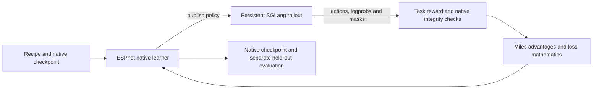

# Speech reinforcement learning with Miles

ESPnet owns the native speech model, preprocessing, sampled-action scoring,
rewards, optimizer and checkpoints. The unchanged Miles library supplies GRPO
advantages, PPO/KL/importance-weight mathematics and bounded asynchronous
orchestration; SGLang supplies rollout scheduling and model layers. Start with
[environment setup](ENVIRONMENT.md), then use one training command:

```bash
python -m espnet2.bin.rl_train --config /absolute/path/to/recipe.yaml
```

This is a local integration, not an already merged upstream release. The older
`rl_launch` and `rl_train_async` module names are compatibility entries. Existing
supervised recipe stages retain their behavior.

## Architecture and ESPnet2 placement

```text
egs2/<model>/<task>/             recipe stages and model/task configuration
espnet2/bin/rl_train.py          public command
espnet2/rl/cli.py                configuration, validation and execution selection
espnet2/rl/                      native trainer and Miles/rollout adapters
espnet2/s2t/rl/                 OWSM policy, exporter, rollout and WER evaluation
espnet2/speechlm/rl/            OpusLM policy, exporter and ASR evaluation
espnet2/speechlm/model/speechlm/rl/bagpiper/
                               Bagpiper policy, data, QA/TTS reward and evaluation
```

ESPnet2 is the integration point because OWSM and SpeechLM already provide the
native model classes, preprocessors, configuration/checkpoint formats and `egs2`
recipes here. Reusing those components preserves the supervised-to-RL boundary
without porting the models or maintaining a second training model. ESPnet3 is
not a prerequisite for this adapter; a later migration should reuse its public
model and training interfaces rather than create a parallel implementation.



The core imports the pinned Miles source, not its Megatron model backend. The
asynchronous adapter binds the original `train_async.py` function to ESPnet
actors; this pin exposes module globals rather than a stable plugin interface.
The adapter and its contract tests must be reviewed when changing that pin.

## Main configurations: one or two H100 GPUs

All main templates use **32 prompts × 8 candidates = 256 responses per update**
and five default updates. Microbatches reduce memory without changing that
batch. Increase `steps` deliberately and provide enough distinct source records.

| Task and recipe directory | One GPU, collocated | Two GPUs, asynchronous | Reward |
| --- | --- | --- | --- |
| OWSM ASR: `egs2/owsm_v4/s2t1` | `conf/rl_miles_wer_1gpu.yaml` | `conf/rl_miles_wer_2gpu_async.yaml` | Negative normalized WER |
| Bagpiper QA: `egs2/bagpiper/speechlm1` | `conf/rl.yaml` | `conf/rl_disagg_async.yaml` | Existing `qa_v1_reward`: accuracy and format, equal weights |
| Bagpiper TTS: `egs2/bagpiper_tts/speechlm1` | `conf/rl.yaml` | `conf/rl_disagg_async.yaml` | Generated audio → frozen ASR → negative WER |

One-GPU `sync` alternates learning and rollout on the same device. Two-GPU
`disagg_async` uses disjoint learner/rollout devices and overlaps one batch,
with at most one version of policy lag. Persistent engines load each published
policy in place. Neither mode creates a cluster allocation or serving group.

Earlier frozen OWSM revisions have complete one-/two-H100 200-update evidence.
This refactor needs a separate GPU regression before inheriting that acceptance.
Bagpiper's one-/two-H100
configurations are templates requiring their own memory, numerical and full-loop
GPU acceptance; four-GPU results do not validate these layouts. No established
held-out quality gain is claimed. Large models also need substantial host RAM
for CPU reference and optimizer state; see [resource planning](ENVIRONMENT.md#resource-planning).

OpusLM remains supported through `egs2/libritts/speechlm1` and its
[task guide](../../egs2/libritts/speechlm1/README_RL_OPUSLM.md). Plain OpusLM's
main template uses two GPUs; no accepted one-GPU profile is claimed. Existing
configuration aliases resolve to the same files, not additional recipes.

## Prepare independent data

Use the selected recipe's ordinary data preparation to obtain real train and
dev splits. ASR joins Kaldi `wav.scp` and `text` by utterance ID, materializes
pipe commands, normalizes audio and records hashes:

```bash
python -m espnet2.rl.prepare --wav-scp data/train/wav.scp \
  --text data/train/text --output data/rl/train.jsonl
python -m espnet2.rl.prepare --wav-scp data/dev/wav.scp \
  --text data/dev/text --output data/rl/dev.jsonl
```

For QA, obtain a local raw train parquet from a fixed revision of
`gijs/avqa-processed`, including audio, questions, choices and reference answers:

```bash
python -m espnet2.rl.qa_data --input /path/to/train.parquet \
  --source-dataset gijs/avqa-processed --source-revision DATASET_COMMIT \
  --source-split train --qa-template default --train-count 3200 \
  --heldout-count 32 --seed 42 --output-dir data/rl/avqa
```

This creates `train.jsonl`, `dev.jsonl`, materialized audio and `admission.json`.
The local dev partition retains its actual source train split; it is not the
official validation/test set. The preparer rejects repeated IDs/audio and can
exclude explicitly provided benchmark manifests with repeatable
`--exclude-manifest`. Its file/decoded-PCM checks do not establish semantic,
component or historical SFT independence. Use a fresh directory and keep the
receipt, audio and manifests together. Private protection registries and
experiment selection/observer scripts are external to the public framework.

For TTS, use a true LibriTTS train split and a separate dev split:

```bash
python -m espnet2.speechlm.model.speechlm.rl.bagpiper.data \
  --dataset libritts --input /path/to/train-split --task tts_asr_wer \
  --max-words 25 --shuffle-seed 42 --output data/rl/tts_train.jsonl
```

Bagpiper's preparer also accepts `--dataset wav_scp --wav-scp ... --text ...`;
QA adds `--questions` and `--choices`. References remain separate from model
inputs. TTS decodes actual eight-stream codec actions, then the pinned ASR
scores the resulting audio. The batched reward is `-min(WER, 1)`; invalid codec
or missing audio scores -1 and is counted. Codec actions, transcripts and
sampled waveform audits remain attached to their candidates.

## Validate and train

Resolve the model, codec/tokenizer/audio assets and the original native training
YAML first. Preserve its modality order, geometry and activation checkpointing.
Set `miles_source`, `sglang_source` and `rollout_python` to the reviewed sources
and interpreter. Low-precision actors require CPU FP32 optimizer master weights.

The same command validates and runs either layout; `--validate-only` performs
configuration/input checks without starting models or checking live Ray placement:

```bash
python -m espnet2.bin.rl_train --config /path/to/one-gpu.yaml \
  --manifest /path/to/train.jsonl --eval-manifest /path/to/dev.jsonl \
  --checkpoint /path/to/native.pth --train-config /path/to/native.yaml \
  --output-dir /path/to/fresh/run --validate-only
```

Remove `--validate-only` to train. Public QA receipts can additionally be bound
with `--data-admission /path/to/admission.json`. Prepare a fresh output directory
for each run; model-only rollout exports do not contain optimizer state.

For two-GPU asynchronous training, activate the reviewed environment on each
host, expose Miles on `PYTHONPATH`, and start a dedicated Ray cluster. On one
host with two available GPUs:

```bash
export PYTHONPATH=/absolute/path/to/miles
ray start --head --num-gpus=2 --port=6379
python -m espnet2.bin.rl_train --config /path/to/two-gpu.yaml \
  --manifest /path/to/train.jsonl --eval-manifest /path/to/dev.jsonl \
  --checkpoint /path/to/native.pth --train-config /path/to/native.yaml \
  --output-dir /path/to/fresh/run --ray-address auto \
  --train-node RAY_NODE_IP --rollout-node RAY_NODE_IP --validate-only
```

For two one-GPU hosts, join both to the dedicated cluster and select their
actual Ray node IDs/IPs separately. Live execution verifies placement. These
commands use existing GPU resources; platform submission and site admission
remain outside the library.

The existing recipe stages call this entry: OWSM stage 18, Bagpiper QA stage 6,
Bagpiper TTS stage 4 and OpusLM stage 10. Recipe `rl.sh` wrappers retain their
preparation options; their training path is the same public module.

## Numerical contracts and advanced modes

The ordinary Miles/PPO objective scores the sampled distribution consistently
in learner, behavior and reference passes. For supported OWSM/Bagpiper paths,
`0 < temperature <= 1`, whole-support sampling (`top_p: 1`, `top_k: -1`) and
recorded multi-stream support are checked before optimization. Other families
and the OWSM vLLM option retain their declared temperature limitations.

Bagpiper QA's optional think profiles are under `conf/advanced/`; their named
reward and parser semantics remain distinct from the main `qa_v1_reward`.
The native final-answer reward (`qa_bagpiper_v2_reward`) extracts a terminal
answer without consulting the reference, then applies correctness 1 + format 0.1.
Changing reward/prompt/parser requires an explicit configuration change and a
matched evaluation, not repointing an old recipe alias.

`egs2/bagpiper/speechlm1/conf/advanced/rl_west_4gpu.yaml` is an **advanced
four-H100** synchronous-disaggregated example. It retains its native-answer
reward, raw-temperature-one full-vocabulary detached-current WEST loss,
sequence/token reduction, k3 KL and top-k 50 sampling at temperature 0.7. Its
protocol logprob pass serves integrity checks, not the loss denominator. This
example disables site-specific periodic evaluation; use the ordinary evaluator
below or supply an explicit external `periodic_eval_function` callback. It is
not the accepted one-/two-GPU recipe, and backend distribution equality is not
established by a mean-error guard.

Optional multi-rank learning retains native all-reduce or PyTorch DDP. Global
advantages and loss denominators precede sharding. CPU optimizer offload stores
FP32 master weights and Adam moments on the owner rank, then broadcasts updated
parameters after gradient averaging/clipping. Two-GPU main profiles use one
learner; additional learners are an advanced configuration.

## Evaluate and inspect a run

OWSM evaluates a native checkpoint on a separate manifest:

```bash
python -m espnet2.s2t.rl.evaluate --config /path/to/run/frozen_config.json \
  --checkpoint /path/to/run/step-000005.native.pth \
  --manifest /path/to/dev.jsonl --output /path/to/fresh/wer.json --device cuda:0
```

Bagpiper QA and TTS use the same task evaluator:

```bash
python -m espnet2.speechlm.model.speechlm.rl.bagpiper.evaluate \
  --config /path/to/run/frozen_config.json \
  --checkpoint /path/to/run/step-000005.native.pth --policy-step 5 \
  --manifest /path/to/dev.jsonl --output /path/to/fresh/evaluation
```

Choose the QA protocol explicitly for native-prompt comparisons; historical
fuzzy answer mapping, exact final choice and format reward are different
metrics. Compare the same complete ordered examples, audio/prompt conditioning,
decoding settings and parser. Training reward changes across different sampled
batches do not establish held-out improvement.

Runs retain actual actions, masks/support, behavior/current/reference logprobs,
policy versions, gradients, timing and native/full optimizer checkpoints. A
full checkpoint includes optimizer masters/moments, schedule, rank RNG and
absolute data cursor. Recovery requires compatible full state; checkpoint
structure checks alone do not prove a crash/restart GPU test. Failure
preservation is bounded: publication failures, process death, broken collectives
and partial optimizer updates are not universally recoverable.

`perf/train_time` covers the learner call; `perf/train_wait_time` covers the
interval since its preceding call, including save/export/rollout/scheduling.
Initial model load and first rollout are excluded from the first wait. Exclude
warmup and periodic-evaluation boundaries for steady-state comparisons, report
full wall time/GPU allocation separately, and never add rollout subwindows to
wait a second time. CPU tests validate contracts, not memory fit, throughput or
quality on the target GPU.
